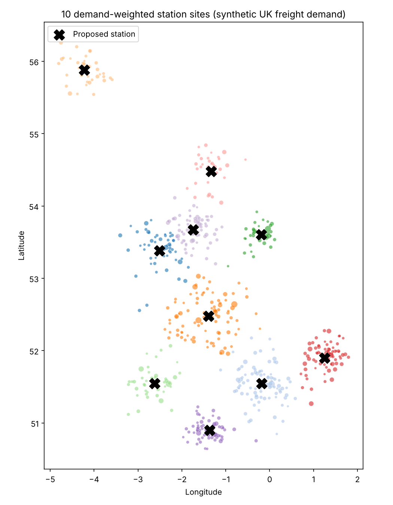
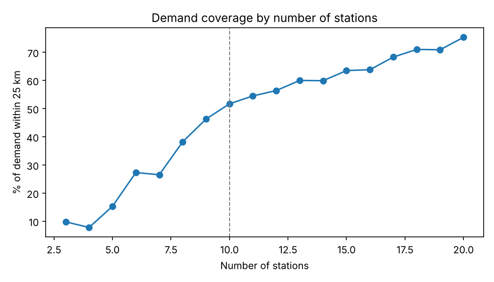

# Hydrogen refuelling station optimisation

Where should the first hydrogen refuelling stations for UK freight go? This project places stations with **demand-weighted K-Means clustering**. It then measures how much demand each layout covers.


> **Data note:** `data/hydrogen_demand.csv` is **synthetic**. It holds 600 simulated demand sites clustered around ten real UK freight hubs, such as Felixstowe, the Midlands golden triangle and Leeds-Bradford. Daily demand per site is drawn from a log-normal distribution. Use your own demand file for real planning.



## Method

1. `src/generate_demand_data.py` creates the synthetic demand sites (seeded, so the results reproduce).
2. `src/optimise_stations.py`:
   - projects latitude and longitude to kilometres, so clustering uses real distances, not degrees
   - runs K-Means with each site **weighted by its daily hydrogen demand**, so stations move towards heavy users
   - measures each site's great-circle (haversine) distance to its assigned station
   - reports **demand coverage**: the share of daily demand within a set radius of a station (25 km by default)
   - repeats the placement for 3 to 20 stations to show the trade-off between station count and coverage

## Results (10 stations, 25 km radius, synthetic data)

- **51.7%** of daily demand is within 25 km of a proposed station.
- The demand-weighted mean distance to a station is **28.0 km**.
- The busiest proposed station, in the Midlands, would serve about 20,700 kg of hydrogen a day.

| Stations | Demand within 25 km | Weighted mean distance |
| --- | --- | --- |
| 5 | 15.3% | 54.1 km |
| 10 | 51.7% | 28.0 km |
| 15 | 63.5% | 22.3 km |
| 20 | 75.3% | 19.5 km |



## Run it

```bash
git clone https://github.com/Samiurr129/hydrogen-refuelling-station-optimisation.git
cd hydrogen-refuelling-station-optimisation
pip install -r requirements.txt
python src/generate_demand_data.py
python src/optimise_stations.py --stations 10 --radius-km 25
```

To use your own data, pass a CSV with `latitude`, `longitude` and `demand_kg_per_day` columns:

```bash
python src/optimise_stations.py --data path/to/your_demand.csv --stations 12
```

## Outputs (`results/`)

| File | Contents |
| --- | --- |
| `proposed_station_locations.csv` | Station coordinates, sites served, demand served, furthest site |
| `clustered_hydrogen_demand.csv` | Each demand site with its station and distance |
| `coverage_by_station_count.csv` | Coverage and mean distance for 3 to 20 stations |
| `station_map.png`, `coverage_curve.png` | Charts |

## Limitations

- Straight-line distance is used, not road distance.
- K-Means places stations at demand centres. It ignores land availability, grid connection and hydrogen supply.
- The demand data is simulated.

## Author

**Samiur Rahman**, DBA candidate researching hydrogen HGV readiness for UK SMEs. Bradford, UK.

[LinkedIn](https://www.linkedin.com/in/samiur-rahman29/) · [GitHub](https://github.com/Samiurr129)
